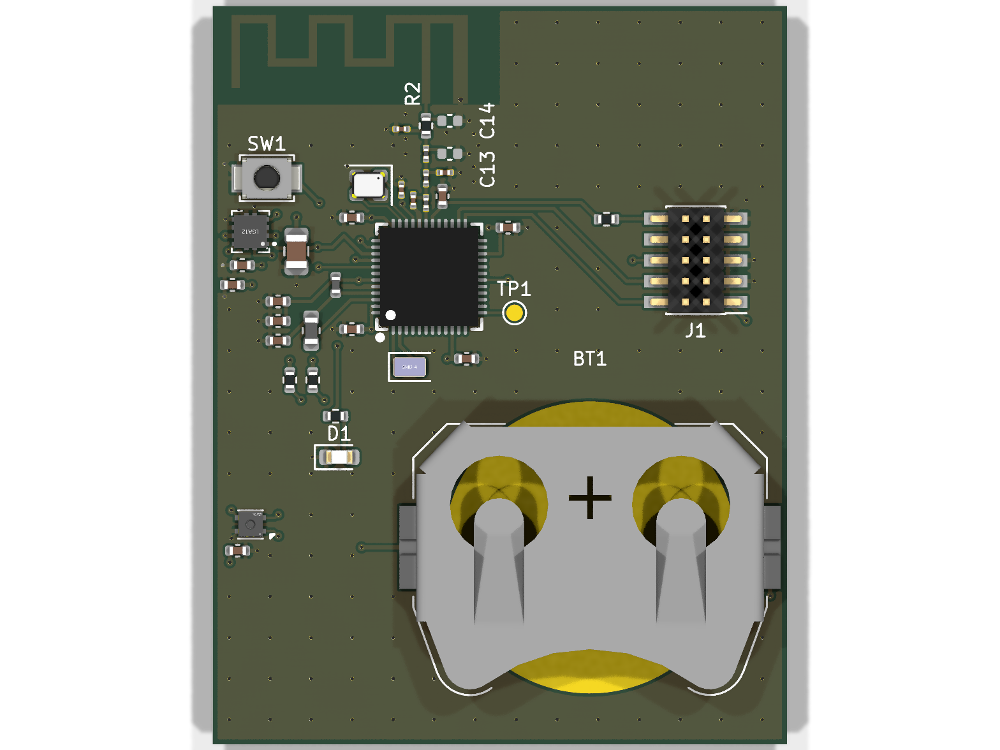
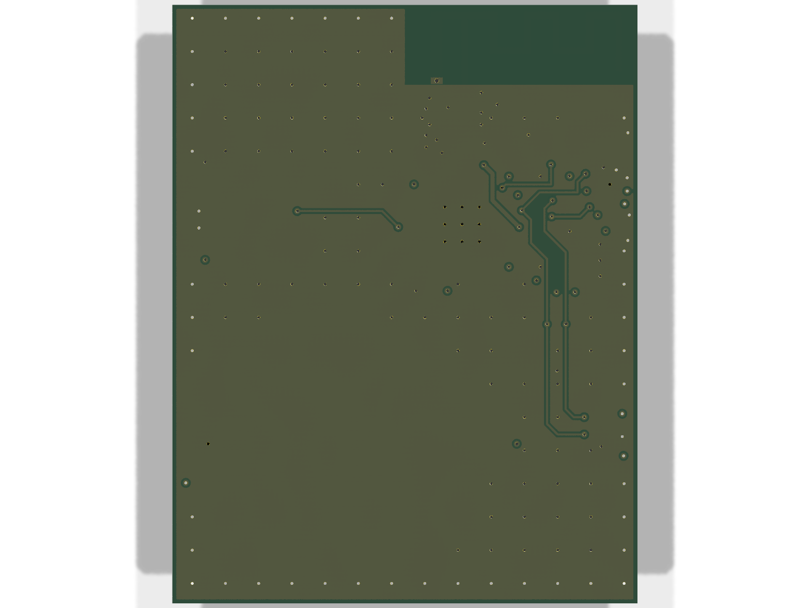

# nRF54L10 BLE Sensor Board

A coin-cell powered Bluetooth Low Energy sensor board designed chip-down around the Nordic **nRF54L10** (QFN48), with its own 2.4 GHz PCB antenna, a tunable π matching network and a 4-layer impedance-controlled stackup. Designed in KiCad 9 for JLCPCB PCBA.

<!-- docs/img/render-top.png and render-bottom.png are generated by scripts/export.sh -->
| Top | Bottom |
|---|---|
|  |  |

## Specs

| | |
|---|---|
| SoC | nRF54L10-QFAA (Arm Cortex-M33, 1 MB RRAM, 192 KB RAM, BLE 6.0) |
| Sensors | SHT40 temperature/humidity, LIS2DH12 accelerometer (wake-on-motion interrupt), shared I²C |
| Power | CR2032, no regulator, internal DC/DC enabled (4.7 µH), 47 µF buffer |
| Clocks | 32 MHz crystal (HFXO) + 32.768 kHz crystal (LFXO), internal load capacitors |
| RF | Nordic reference matching network (0201) → 0 Ω + 2× DNP π network → PCB inverted-F antenna |
| Debug | 10-pin 1.27 mm Cortex Debug (SWD + SWO), test point for current-measurement sync |
| UI | 1 button, 1 LED |
| PCB | 35 × 45 mm, 4 layers, JLC04161H-1080 stackup, ENIG |

## Design decisions

**nRF54L10 instead of nRF52.** The nRF52 has many open designs online; the nRF54L series is newer and lower power. The L15 was out of stock at JLCPCB, so the pin-compatible L10 was used; the schematic symbol was checked pin by pin against both parts.

**Coin cell without a regulator.** The nRF54L runs directly from 1.7–3.6 V, so a regulator would only add quiescent current. The internal DC/DC converter is used, with the inductor and decoupling taken from the Nordic reference design.

**32.768 kHz crystal.** The internal RC oscillator drifts with temperature and needs periodic calibration with the 32 MHz oscillator running. Its larger clock uncertainty also widens the BLE receive window. A small crystal is cheaper than that extra current.

**LIS2DH12 interrupt for wake-up.** The accelerometer stays in low-power mode and wakes the SoC from System OFF on motion, so the radio only works when something happens. SA0 is tied to VDD (address 0x19) because tying it to GND would draw current through the internal pull-up.

**RF path.** The matching network between the SoC and the 50 Ω point follows the Nordic QFAA reference layout component by component (Murata 0201 parts), including the ground return of the VSS_PA shunt capacitor on the top layer only. After the 50 Ω point, a 0402 π network (0 Ω + two unpopulated pads) allows the antenna to be tuned with a VNA without a board respin.

**Stackup.** JLC04161H-1080: 0.0764 mm prepreg (εr 3.91) between the top layer and the solid ground plane. A thin L1–L2 dielectric keeps the ground close under the ANT pin, as Nordic recommends for harmonic suppression, and gives a narrow 50 Ω line that fits the 0201 pads.
50 Ω grounded coplanar waveguide: **W = 0.13 mm, gap = 0.15 mm**.

| Layer | Use |
|---|---|
| L1 | RF, components, signals |
| L2 | Solid GND |
| L3 | VDD + a few signals |
| L4 | Signals + GND pour |

All components, including the coin-cell holder, are on the top side, so the board needs only single-sided assembly.

## Layout

**RF corner.** The SoC, the matching network and the antenna feed sit on one straight vertical line, so the RF path from the ANT pin to the antenna is as short as possible and has no bends. The antenna area is kept free of copper on all four layers, and a row of ground vias fences the RF path.

**DECA / DECRF link.** As in the Nordic reference layout, the DECRF pin is decoupled right at the pin. A via behind that capacitor connects it on the bottom layer to the DECA pin and the ferrite bead output.

**QFN fan-out.** The 0.4 mm pitch pins on the left side carry the button, LED, I²C, accelerometer interrupt and the DC/DC loop. To give them space to escape, the I²C pull-ups were moved away from the SoC onto the bus near the humidity sensor. Signals that cannot leave on the top layer change to the bottom layer, so the L2 ground plane under all top-layer signals stays unbroken.

**Ground.** L2 is a solid ground plane, and L1 and L4 have ground pours. These are stitched together with vias on a 2.5 mm grid (about λ/25 at 2.4 GHz). Every trace is routed at 0°, 45° or 90°.

**Checks.** ERC and DRC (including schematic parity) report 0 violations. The reports are in `fab/`.

## Manufacturing (JLCPCB)

1. Upload `fab/nrf54-ble-sensor-gerbers.zip`. Select 4 layers, 1.6 mm, ENIG, impedance control with the **JLC04161H-1080** stackup.
2. For assembly, upload `fab/nrf54-ble-sensor-bom.csv` and `fab/nrf54-ble-sensor-cpl.csv`. C13 and C14 are intentionally not populated (π network tuning pads).
3. Check part rotations in the JLCPCB placement preview, especially for the QFN, LGA and crystals.

## Status

- **v1.0, design complete:** schematic, layout and manufacturing files are finished and pass all checks.
- **Next:** order and assemble the board, bring-up over SWD, BLE advertising test, then antenna tuning with a NanoVNA and sleep-current measurement.

## Repository

```
nrf54-ble-sensor.kicad_*   KiCad 9 project
lib/                       custom symbols/footprints (nRF54L QFN48, LIS2DH12 LGA-12) and 3D models
docs/                      schematic PDF, renders
fab/                       Gerbers, drill, BOM and CPL for JLCPCB, ERC/DRC reports
scripts/export.sh          rebuilds all outputs with kicad-cli
```

Rebuild outputs: `bash scripts/export.sh`

The 3D models of the crystals and the SHT40 in `lib/parts.3dshapes` come from the LCSC/EasyEDA part library.

## References

- Nordic Semiconductor, nRF54L15 Product Specification and QFAA reference layout v0.8
- Nordic DevZone notes on ANT pin ground distance and harmonics
- JLCPCB impedance-controlled stackups (jlcpcb.com/impedance)
